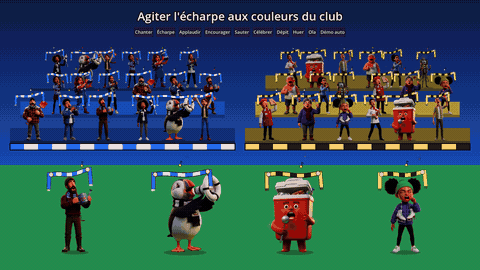
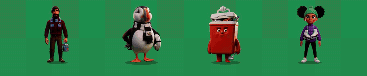

# Animation des FANZZY

Module autonome dans `scenes/fanzzy/`. Il anime n'importe quel FANZZY à partir
de son image, sans découpage ni squelette, et remplit des tribunes entières.



## Pourquoi pas un squelette (Skeleton2D) ?

Les FANZZY sont des images entières (rendus 3D, 520 x 945). Un squelette
demanderait de découper bras, jambes et tête sur **1 664 personnages** et leurs
skins, à la main. On anime donc l'image entière :

- une **grille déformée par un shader** (`fanzzy_deformation.gdshader`) : les
  pieds restent fixes, le buste se plie, s'écrase, s'étire ou ondule ;
- des **mouvements procéduraux** (saut cartoon, balancement, coups de poing sur
  le temps) calés sur le **tempo** commun de la tribune ;
- des **accessoires dessinés** : écharpe aux couleurs du club, notes de
  musique, confettis, nuage de pluie, symboles de colère, étincelles ;
- le **changement d'expression et de pose** (neutre, pousse, joie, depit,
  colere), plus le clignement des yeux ;
- des **bras qui bougent vraiment** dans les poses bras levés (voir plus bas).

Avantage : chaque nouveau FANZZY ou skin est animé sans travail à la main.
Si un FANZZY phare mérite mieux, on pourra lui faire plus tard un rig
Skeleton2D dédié avec la même interface (`jouer(action)`).

## Bras qui bougent

Les poses `joie` (deux bras levés) et `pousse` (un bras levé) sont pliées
autour des épaules par le shader : le bras tourne à l'épaule, l'avant-bras
tourne un peu plus (effet « bras caoutchouc » cartoon). Rien ne bouge sous les
épaules ni dans la bande de la tête, et comme c'est une déformation continue
de l'image, il n'y a ni trou ni découpe visible.

Pour savoir où sont la tête, les épaules et les poings, on analyse les images
une fois pour toutes :

```sh
python3 tools/fanzzy/analyser_bras.py assets/fanzzy/demo        # échantillon du dépôt
python3 tools/fanzzy/analyser_bras.py /chemin/vers/etats --jobs 8
```

L'outil écrit un `bras.json` à côté des expressions de chaque skin (yeux du
calque `cligne`, tête retrouvée dans la pose, silhouette sans la tête : ce qui
monte au-dessus des yeux, ce sont les bras). Sans `bras.json`, le FANZZY garde
l'animation d'avant (bras fixes dans la pose).



Ce que ça donne :

- **agiter l'écharpe** : bras levés, l'écharpe aux couleurs du club tendue
  entre les deux poings (derrière la tête), les bras balancent ensemble de
  gauche à droite et les pans flottent ;
- **lever les bras** (nouvelle action) : les bras montent depuis le côté,
  puis restent en V avec les poings qui tremblent ;
- **applaudir** : les mains se rejoignent au-dessus de la tête sur le tempo ;
- **célébrer** : poings levés en alternance ; **sauter** : les bras battent
  avec le saut ;
- **chanter** / **encourager** (pose `pousse`) : le bras levé suit le
  balancement, ou frappe sur le temps ;
- à chaque changement de pose, les bras levés retombent sur le côté avant de
  changer d'image, et remontent dans la nouvelle pose.

Limites : l'analyse se fait sur la silhouette, sans IA. Sur les FANZZY très
peu humains (objets, véhicules) ou quand un chapeau très large touche les
bras, un bras peut ne pas être repéré (il reste alors fixe) ou entraîner un
bout de chapeau avec lui. Les bras baissés de la pose `neutre` ne bougent pas
(ils sont collés au corps).

## Actions

| Action | Expression | Durée par défaut | Effet |
|---|---|---|---|
| `repos` | neutre | boucle | respiration, léger balancement |
| `chanter` | pousse | boucle | balancement en rythme, notes de musique |
| `lever_bras` | joie | boucle | bras qui montent, poings qui tremblent |
| `agiter_echarpe` | joie (sinon pousse) | boucle | écharpe tendue entre les poings, bras qui balancent |
| `applaudir` | joie | boucle | mains qui se rejoignent au-dessus de la tête, étincelles |
| `encourager` | pousse | boucle | poing levé sur le temps |
| `sauter` | joie | boucle | sauts cartoon (écrasé, étiré) |
| `celebrer` | joie | 3 s | grands sauts, éclat, confettis |
| `depit` | depit | 3 s | s'affaisse, se ternit, nuage de pluie |
| `huer` | colere | 2,5 s | tremble de rage, symboles de colère |

## Le « jus » : élastique, impacts, traînées

Par-dessus chaque action, une couche de réactions physiques façon jeu
d'action cartoon rend les FANZZY plus vivants. Elle marche sur toutes les
images, avec ou sans expressions.

| Appel | Effet |
|---|---|
| `pop(force)` | coup d'élastique (squash & stretch) qui rebondit 2 ou 3 fois ; `force` < 0 étire d'abord |
| `impact(depuis, force, couleur)` | éclair de couleur, écrasé, recul à l'opposé du coup, onde et étoiles d'impact |
| `rebondir(force, delai)` | un bond par-dessus l'action en cours, poussière à l'atterrissage |
| `etourdir(duree)` | étoiles qui tournent au-dessus de la tête |
| `poussiere(n, force, cote)` | bouffée de poussière aux pieds, posée dans la scène |
| `trainee = 0.3` | silhouettes fantômes (teinte `couleur_trainee`) pendant 0,3 s |

Automatique : chaque changement d'action démarre d'un coup d'élastique
(célébrer étire et lance des étoiles, dépit écrase, huer fait trembler),
la course soulève un peu de poussière à chaque pas, et tout atterrissage
(sauter, célébrer, bond) fait un nuage. `poussiere_auto = false` coupe la
poussière.

Où c'est branché :

- **Accueil** : la foule est faite de vrais FANZZY animés (tes FANZZY
  d'abord), qui chantent, agitent l'écharpe ou applaudissent sur le même
  tempo, sautent à leur place à l'arrivée, font un bond de temps en temps
  et célèbrent quand on clique dessus.
- **Duel d'ambiance** : les trois FANZZY du premier plan sont maintenant
  des FanzzyAnime (expressions et bras) ; élastique sur chaque temps du
  tambour, bond sur chaque note réussie, applaudissements au combo 10,
  écharpes au tifo, bras levés à la ola, célébration ou dépit au but et à
  la fin, éclair rouge et colère sur un raté.
- **Arène** : impact au coup reçu (recul à l'opposé du tireur), secousse
  d'écran quand ton FANZZY touche ou est touché, plus forte au KO et au
  super, étoiles quand il est étourdi ou mis au banc, traînée pendant la
  roulade et le sprint, bond au retour du banc.
- **Poussée** : impact au coup reçu, étourdi quand une unité va s'asseoir,
  bond et traînée à l'entrée sur le terrain.

Démo : `scenes/fanzzy/demo_jus.tscn` (séquence en boucle). Test :
`godot --headless --path . --script tests/test_jus.gd`.

## Utilisation

Un FANZZY seul :

```gdscript
var f := FanzzyAnime.creer("MT14")   # évolution e1, skin base
var g := FanzzyAnime.creer("MT14", "e2", "halloween")
f.position = Vector2(400, 900)       # position = entre les pieds
f.scale = Vector2.ONE * 0.3          # les images font 945 px de haut
f.couleurs_echarpe = [Color("1e6bff"), Color("ffffff")]
add_child(f)
f.jouer(&"chanter")                  # en boucle
f.jouer(&"celebrer", 2.0)            # 2 s puis retour au repos
f.jouer(&"sauter", -1, 0.5)          # dans 0,5 s, durée par défaut
```

Une tribune :

```gdscript
var t := TribuneFanzzy.new()
t.fanzzy_ids = ["MT14", "AN22", "AN2"]   # répétés pour remplir les places
t.couleurs = [Color("ffd23f"), Color("1a1a1a")]
t.rangees = 3
t.places_par_rangee = 6
t.bpm = 128          # tempo des chants
t.energie = 0.8      # 0 = calme, 1 = bouillante
add_child(t)

t.reagir(&"but")         # but, but_adverse, occasion, faute, chant, tifo, pression
t.ola()                  # vague de gauche à droite
t.jouer_tous(&"applaudir", 3.0)
```

Pour le duel d'ambiance, il suffit de brancher les événements du duel sur
`reagir()` et de régler `energie` selon la jauge d'ambiance de chaque tribune.

## Où sont cherchées les images

`FanzzyAnime.creer(id, evolution := "e1", skin := "base")` cherche, dans
`assets/fanzzy/sprites/` puis `assets/fanzzy/demo/` :

1. les expressions au format de l'export TheBestFan :
   `<id>/<evolution>/<skin>/<etat>.webp`, avec `etat` parmi `neutre`, `pousse`,
   `joie`, `depit`, `colere` et `cligne` (yeux fermés, facultatif), plus
   `bras.json` (repères des bras, voir plus haut). Si le skin
   n'a pas l'expression, celle du skin `base` est prise ;
2. formats simples acceptés aussi : `<id>/<etat>.webp`, `<id>_<etat>.webp`,
   `<id>-<etat>.webp` ;
3. à défaut d'expressions, la vignette seule `<id>.webp`.

L'expression `neutre` sert d'image de base (même cadrage que les autres, pieds
au même endroit). Il manque une expression ? L'image de base la remplace.
Les expressions sont de vraies poses (bras levés pour `joie`, main sur le
visage pour `depit`, doigt pointé pour `colere`…) : le changement d'action
change donc aussi la posture, et l'animation procédurale s'ajoute par-dessus.

`assets/fanzzy/demo/` contient l'évolution e1, skin base, de 18 FANZZY pour la
démo (5,3 Mo). Les 17 161 expressions complètes (~900 Mo) ne sont pas dans le
dépôt.

## Démo

Ouvrir `scenes/fanzzy/demo_animations.tscn` et lancer la scène (F6). La
séquence tourne en boucle ; les boutons du haut testent chaque action.

Pour en faire une vidéo :

```sh
godot --path . --write-movie demo.avi --fixed-fps 30 --quit-after 1130 \
    res://scenes/fanzzy/demo_animations.tscn
```

## Performances

Chaque FANZZY = une grille de 20 x 44 cases (partagée entre images de même
taille) et un matériau. Une tribune de 18 FANZZY tourne sans problème en rendu
Compatibilité. Pour de très grandes foules (plusieurs centaines), il faudra
passer les rangées du fond en sprites simples sans shader.
