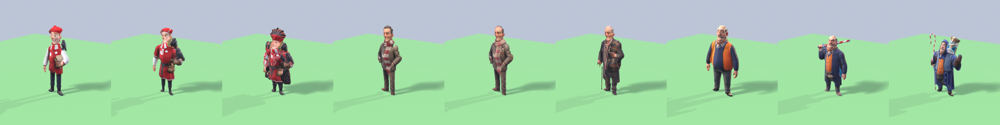

# FANZZY en 3D

Les FANZZY des modes **Arène** et **Poussée** et du **salon en ligne** sont des
modèles 3D animés quand leur fichier `assets/fanzzy/3d/<skin>.glb` existe.
Sinon le jeu garde l'image animée (`FanzzyAnime`).



## Dans le jeu

`scenes/fanzzy/fanzzy_3d.gd` (`Fanzzy3D`) a la même interface que
`FanzzyAnime` (`jouer`, `action`, `cap`, `vitesse_course`, `_rect`) :

- `Fanzzy3D.creer_corps(id)` : 3D si le modèle existe, sinon l'image animée ;
- `orienter(direction)` : le FANZZY se tourne vraiment vers où il court ;
- `Fanzzy3D.vignette(id)` : un `TextureRect` qui montre le FANZZY en attente (salon).

Le modèle est rendu dans un `SubViewport` transparent (caméra orthographique,
plongée de 25°), affiché par un `Sprite2D` dont l'origine est entre les pieds.

| Action du jeu | Animation du modèle |
|---|---|
| repos | attente (boucle) |
| marcher, courir | course (boucle, vitesse variable) |
| lancer, chanter, encourager | lancer |
| celebrer, sauter, lever_bras, applaudir, danser | victoire (boucle) |
| depit, huer | depit |

Test : `godot --headless --path . --script tests/test_fanzzy_3d.gd`.
Pour voir son équipe en 3D : `-- --scene=arene --match=<id> --auto --equipe=AN1,TR33,GD3`.

## Fabriquer les modèles (gratuit, automatique)

`tools/fanzzy3d/` part de l'image d'un skin (PNG de thebestfan, 520 x 945) :

1. `preparer.py` : repères du corps avec MediaPipe Pose (Apache 2.0), puis
   découpe tête / buste / jambes / bras, épaisseur « gonflée » à partir de la
   silhouette, texture de face et texture de dos (face floutée, arrière de la
   tête couleur cheveux ou chapeau). Les halos des skins B/C sont retirés.
2. `fanzzy3d.py` (Blender 5.2) : corps d'un seul tenant + deux bras à part,
   squelette de 12 os (racine, hanches, torse, tete, bras/avantbras, cuisse/tibia
   .L/.R) et 5 actions : attente, course, lancer, victoire, depit. Export .glb.
3. `rendu.py`, `video.sh` : images et vidéo de contrôle.

```sh
python -m venv venv && venv/Scripts/pip install mediapipe pillow scipy
curl -L -o pose.task https://storage.googleapis.com/mediapipe-models/pose_landmarker/pose_landmarker_heavy/float16/latest/pose_landmarker_heavy.task
PY=venv/Scripts/python POSE=pose.task IMG=.../thebestfan/public/img/fanzzy BLENDER=blender \
  sh tools/fanzzy3d/construire.sh AN1 AN1B AN1C
```

Les fichiers sortent dans `prep/`, `modeles/` et `rendus/` à côté du dossier
`tools/fanzzy3d/` ; copier les `.glb` dans `assets/fanzzy/3d/`.
Environ 1 Mo et 11 000 triangles par skin, 3 s de Blender.

Limites connues : le dos est déduit de la face, les profils sont un peu plats,
un accessoire tenu (canne, bâton) suit le bras le plus proche.
